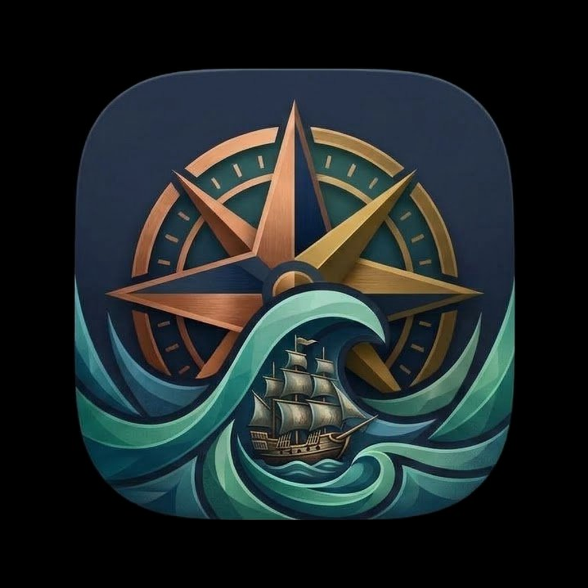

<p align="center">
  
</p>

<h1 align="center">Notscape Mariner</h1>

<p align="center">
  A reading- and media-first Android web browser — private and local-only
  by design, with ad and tracker blocking, a built-in media player and
  downloads, a full e-book reader with read-aloud, playlists, and an
  encrypted password vault. Everything runs on your device.
</p>

<p align="center">
  <a href="https://github.com/DocBobert6/NotscapeMariner/releases">
    
  </a>
</p>

## Status

**Beta — in active development.** Signed beta builds are published on the
[Releases](https://github.com/DocBobert6/NotscapeMariner/releases) page,
and the app checks for updates itself: an available update is offered
in-app, and its download is verified against the release's published
hash and signing certificate before it is installed. Features are still
being refined, so expect regular updates.

## Overview

Notscape Mariner is a full web browser built around reading, watching, and
listening. Bookmarks, history, playlists, books, downloads, and passwords
are stored on the device only. There are no accounts, no analytics, and
no telemetry. The only network requests the app itself makes are
downloading filter lists and checking for updates.

## Features

### Browser
- Tabs in a grid or list view, with named tab groups, a separate section
  for private tabs, recently closed tabs, and session restore
- Floating address bar that can sit at the top or bottom of the screen,
  with an optional home button and a loading progress fill
- Start page with favourites, frequently visited sites, and a choice of
  wallpapers — including your own photo, adjustable to frame; optional
  custom homepage
- Bookmarks with folders, history grouped by day, find in page, save a
  page as PDF, screenshots, share, long-press menus, desktop site mode,
  text zoom, and an immersive full-screen mode
- Strict popup blocking with a per-site allow list — allowed popups open
  as real tabs, so login and player windows keep working; pop-under
  navigations are caught as well
- Per-site controls for JavaScript, images, popups, and blocking
- Tracking-parameter cleaning for copied and shared links
- Reader mode that presents web articles in the built-in reader, with an
  option to save articles to the bookshelf

### Blocking and privacy
- Ad and tracker blocking from seven maintained filter lists (including
  EasyList, EasyPrivacy, AdGuard Base, and a hosts blocklist),
  downloaded and cached on-device
- List rules are honoured as written — path- and site-scoped rules,
  rule exceptions, and cosmetic rules that hide ad containers network
  blocking leaves behind
- Blocking can be turned off per site; cookie controls and per-site
  cookie exceptions included
- Private tabs run in their own browsing profile and leave nothing
  behind

### Media
- "Find media on page" detects videos, audio, and streams (including
  HLS and DASH) on the page and in its network traffic, with a shortcut
  in the address bar when media is found
- Built-in player with background playback and system media controls,
  resume positions, gesture controls for brightness, volume, and
  seeking, playback speed, picture-in-picture, a listen mode for
  audio-only playback, and a sleep timer
- Video quality selection where a stream offers more than one quality
- Subtitle styling: font (including your own imported font), size,
  colour, background, and edge style
- Playlists with multi-select tools

### Downloads
- Downloads go to the phone's Downloads folder through the system
  download manager, with correct file names and types resolved from
  the server
- Stream (HLS) downloads are assembled into a single playable file,
  including encrypted streams
- Media downloads are kept in an offline library for watching and
  listening without a connection

### Reader
- Bookshelf for EPUB and TXT books, with list or cover-tile views
- Chapter navigation and table of contents, in-book search, and
  bookmarks (ribbons) inside books
- Read-aloud with downloadable offline voices (two voice engines, a
  choice of voices and speeds), follow-along highlighting, and a sleep
  timer — playback continues in the background
- Scrolling or page-by-page reading; in landscape, a two-page spread
  with a page-curl turn
- Typesetting controls: font family and size (including your own
  imported fonts), line spacing, margins, alignment; reading themes;
  keep-screen-awake; time-left estimates
- Reading progress is always saved

### Vault and data
- On-device password vault, encrypted with the Android Keystore and
  unlocked with biometrics; it locks itself again automatically
- Logins can be filled into web pages from the vault
- Export and import a full backup; the vault exports separately,
  encrypted with a passphrase
- In-app update checks against this repository's releases, with hash
  and signature verification before installing

## Download

Signed APKs are published on the
[Releases](https://github.com/DocBobert6/NotscapeMariner/releases) page
(beta builds). Requires Android 7.0 (API 24) or newer.

## Building from source

Requirements: JDK 17 and the Android SDK (platform 36).

```sh
./gradlew :app:assembleRelease
```

Release signing is supplied through environment variables
(`ANDROID_KEYSTORE_FILE`, `ANDROID_KEYSTORE_PASSWORD`, `ANDROID_KEY_ALIAS`,
`ANDROID_KEY_PASSWORD`); without them the build produces an unsigned APK.
Builds pushed to this repository are compiled by GitHub Actions, which
also publishes the signed APK to Releases.

## Project

- Package: `net.notscape.browser`
- Stack: Kotlin, Jetpack Compose, Android WebView, Media3 (ExoPlayer)
- Min SDK 24 · Target SDK 36
- Status: beta, in active development — see [PLAN.md](PLAN.md) for
  scope and roadmap

## License

Personal project — all rights reserved.
